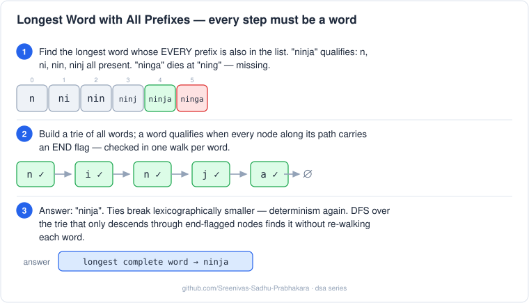

# Longest Word with All Prefixes

> Striver SDE Sheet 187 · Day 27 Trie — insert everything, then test each word's path demanding a word-end flag at *every* node along it. Go, stdlib only, tested.

## Problem

Find the longest "complete string" in a list: a word all of whose prefixes are themselves in the list ("ninja" qualifies only if n, ni, nin, ninj do too). Ties go to the lexicographically smaller; none qualifies → empty string.

## Approach

The property is tailor-made for a trie: insert all words, then for each candidate walk its path checking `isWord` at **every** step — not just the last. A single flag miss anywhere disqualifies. That per-step check is O(len) per candidate, giving O(total characters) overall, versus hashing every prefix of every word into a set (same asymptotics, more allocation). Tie-breaking happens in plain comparison during the scan: longer wins, equal lengths prefer the smaller string.

**Complexity:** O(total characters) time and space.

## Visual walkthrough

Read the picture top to bottom — each numbered frame is one moment of the algorithm
running on this repo's test example.

## Run

    go test ./...   # verify
    go run .        # demo

---

One of 191 repos solving Striver's SDE Sheet in Go — stdlib only, one problem per repo, every solution tested. Browse the set: [`dsa-*` repos](https://github.com/Sreenivas-Sadhu-Prabhakara?tab=repositories&q=dsa-&type=source).
